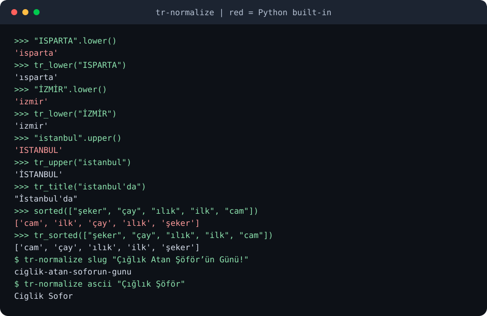

# tr-normalize

[](https://github.com/YusufBeratZengin/tr-normalize/actions/workflows/ci.yml)
[](https://pypi.org/project/tr-normalize/)
[](LICENSE)
[](pyproject.toml)

[English](README.md) | Türkçe

Türkçe için doğru `lower`, `upper`, `title` ve `casefold`; alfabetik sıralama, ASCII'ye katlama, slug üretimi ve metin temizliği. Hem Python kütüphanesi hem komut satırı aracı.
Yalnızca standart kütüphane: bağımlılık yok, tip bilgisi tam, locale ayarı gerekmez, ağ kullanmaz.

```sh
pip install tr-normalize   # henüz yayımlanmadı; şimdilik klonlanmış klasörde `pip install .`
```

```python
from tr_normalize import tr_lower, tr_upper, tr_title, tr_sorted

tr_lower("IĞDIR İZMİR")  # 'ığdır izmir'
tr_upper("ılık iyi")  # 'ILIK İYİ'
tr_title("istanbul'da")  # "İstanbul'da"
tr_sorted(["şeker", "çay", "ılık", "ilk"])  # ['çay', 'ılık', 'ilk', 'şeker']
```

```sh
tr-normalize slug "Çığlık Atan Şöför’ün Günü!"   # ciglik-atan-soforun-gunu
```

## Demo



Görsel, `python scripts/make-demo.py` ile gerçek çıktıdan üretilir. Kırmızı satırlar Python'un yerleşik metotlarıdır.

## Python'un `str.lower()` metodu Türkçede neden yanlış?

Türkçede iki ayrı `i` vardır: noktalı (`i`/`İ`) ve noktasız (`ı`/`I`). Python,
dile bağlı olmayan Unicode varsayılanlarını kullanır:

| Çağrı | Python'un sonucu | Doğru Türkçe |
|---|---|---|
| `"ISPARTA".lower()` | `'isparta'` | `'ısparta'` |
| `"İZMİR".lower()` | `'i̇zmi̇r'` (`i` ve arkasında U+0307 birleşik nokta) | `'izmir'` |
| `"istanbul".upper()` | `'ISTANBUL'` | `'İSTANBUL'` |
| `sorted(["çay", "cam", "ılık", "ilk"])` | `['cam', 'ilk', 'çay', 'ılık']` | `['cam', 'çay', 'ılık', 'ilk']` |

Düz `sorted()` kod noktasına göre sıralar; bu yüzden `ç ğ ı ö ş ü` tüm ASCII harflerden sonraya düşer.

## Kurulum

```sh
pip install tr-normalize
```

Python 3.10 veya üstü gerekir. İlk sürüm PyPI'a çıkana kadar klonlanmış klasörde `pip install .` kullanın.

## Kullanım

### Kütüphane

| Fonksiyon | Ne yapar |
|---|---|
| `tr_lower(s)`, `tr_upper(s)` | Türkçe büyük/küçük harf. `I`↔`ı`, `İ`↔`i`; ayrışık `I` + U+0307 de anlaşılır. |
| `tr_title(s)` | Baş harfleri büyütür. Kelime içindeki kesme işareti yeni kelime başlatmaz: `istanbul'da` yazısı `İstanbul'da` olur. |
| `tr_casefold(s)` | Karşılaştırma için harf duyarsız biçim: `tr_casefold("IŞIK") == tr_casefold("ışık")`. |
| `tr_sort_key(s)`, `tr_sorted(items, key=, reverse=)` | Türkçe alfabe sırası `a b c ç d e f g ğ h ı i j k l m n o ö p r s ş t u ü v y z`. Rakam ve noktalama önce gelir; eşitlikte küçük harf büyükten önce. |
| `to_ascii(s)` | `ç ğ ı ö ş ü â î û` harflerini `c g i o s u a i u` yapar (büyükleri de; `İ` → `I`). Diğer her şeye dokunmaz. |
| `tr_slugify(s, separator="-", max_length=None)` | ASCII, küçük harfli URL slug'ı. Kesme işareti atılır: `Şöför’ün` → `soforun`. |
| `normalize_whitespace(s, keep_newlines=False)` | Her türlü Unicode boşluğu (NBSP dahil) tek boşluğa indirir; sıfır genişlikli boşluk, yumuşak tire ve BOM'u siler. |
| `normalize_quotes(s)`, `normalize_apostrophes(s)` | Kıvrık ve tipografik tırnakları düz `"` ve `'` yapar. |
| `nfc(s)` | Unicode NFC (birleşik biçim). |
| `normalize(s, whitespace=True, quotes=True, keep_newlines=False)` | Önce NFC, sonra tırnaklar, sonra boşluklar. |

`to_ascii`, "deasciify" araçlarının tersi yöndedir: aksanları kaldırır, geri getirmez.

### Komut satırı

```sh
tr-normalize <komut> [metin ...]       # metin verilmezse standart girdiyi okur
python -m tr_normalize <komut> ...
```

| Komut | Etki |
|---|---|
| `lower`, `upper`, `title`, `casefold` | Harf büyüklüğü dönüşümü |
| `ascii` | Türkçe harfleri ASCII'ye katlar |
| `slug [--sep S] [--max-length N]` | Slug (standart girdide satır başına bir tane) |
| `clean [--keep-newlines] [--no-quotes]` | NFC, düz tırnak, düzenli boşluk |
| `sort [-r] [-u]` | Satırları Türkçe sıraya dizer; tersine çevirir veya tekrarları atar |

Çıktı her zaman UTF-8'dir. Çıkış kodu `0`; kullanım hatasında `2`.

## Örnekler

`examples/basic.py` ve gerçek çıktısı:

```text
ığdır izmir
ILIK İYİ
İstanbul'da Ve Ankara’da
Ciglik Sofor Uc Agac
ciglik-atan-soforun-gunu
['cam', 'çay', 'ılık', 'ilk', 'su', 'şeker']
"Merhaba" dünya
```

Şehir adlarından oluşan bir dosyayı sıralamak (`examples/cities.txt`):

```sh
tr-normalize sort < examples/cities.txt
# Ağrı Çanakkale Çorum Iğdır Isparta İzmir Ordu Sivas Şanlıurfa Zonguldak (her biri ayrı satırda)
```

## Nasıl çalışır

Türkçede davranışı değişen harfler (`I`, `i`, `İ`, `ı`) elle işlenir; geri kalan karakter
dizileri değiştirilmeden `str.lower` / `str.upper` / `str.casefold`'a verilir. Böylece
Yunanca sondaki sigma, `ß` ve Azerice `ə` normal Unicode davranışını korur.
Sıralama bir demet (tuple) anahtar üretir: önce Türkçe alfabedeki konuma göre harfler, sonra aksanlar, sonra büyük/küçük harf.

## Sınırlar

- Sıralama pratik bir alfabetik sıradır; tam ICU/CLDR harmanlaması değildir (Türkçe harfler dışında dile özgü uyarlama yok, boşluk ve noktalama yok sayılmaz).
- `tr_title` her kelimeyi büyütür; bağlaç gibi Türkçe istisnaları bilmez.
- `i`/`I` harfinden hemen sonra gelen U+0307, `tr_lower`/`tr_casefold` tarafından gereksiz sayılıp silinir. Türkçe ve Azerice için doğrudur, Litvanca için değildir.
- `to_ascii` ve `tr_slugify` Latin dışı yazıları çevirmez; ASCII karşılığı olmayan karakteri `to_ascii` olduğu gibi bırakır, `tr_slugify` atar.
- Diğer dillerin harfleri (örneğin Azerice `ə`) büyük/küçük harf fonksiyonlarında standart Unicode kuralının ötesinde değiştirilmez.

## Geliştirme

```sh
git clone https://github.com/YusufBeratZengin/tr-normalize.git
cd tr-normalize
python -m pip install -e ".[dev]"
python -m ruff check . && python -m ruff format --check .
python -m mypy
python -m pytest            # %85 kapsam alt sınırını içerir
python scripts/make-demo.py # docs/demo.svg dosyasını yeniden üretir
```

## Katkı

[CONTRIBUTING.md](CONTRIBUTING.md) dosyasına bakın. Güvenlik bildirimleri için: [SECURITY.md](SECURITY.md).

## Lisans

[MIT](LICENSE)
